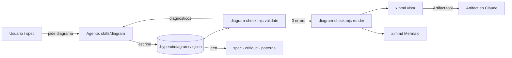
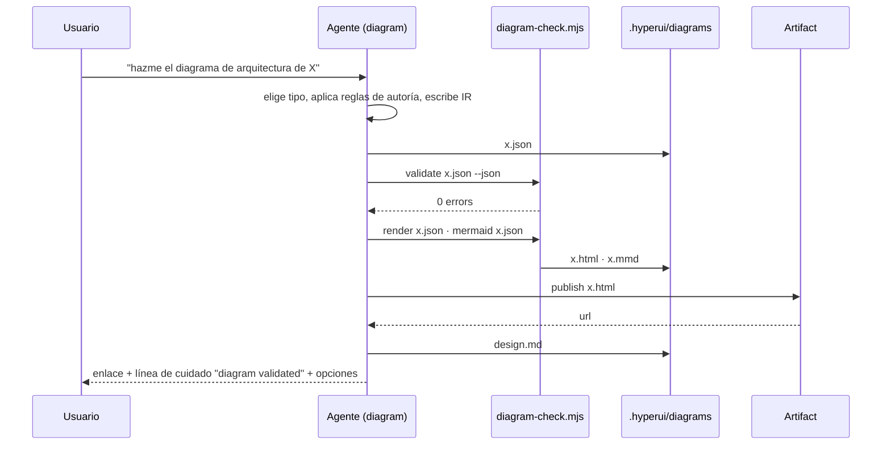
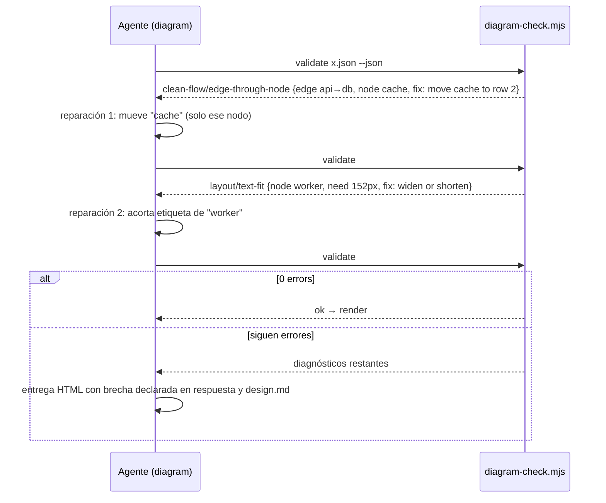

# Diseño: Especialista `diagram` — IR tipada, validador sin dependencias, visor autocontenido

**Date:** 2026-10-08
**Track:** full

## Summary
Cambio **multi-componente dentro del plugin** (shape: multi-page de herramienta + un pipeline de datos, sin backend): una skill nueva (`skills/diagram/`), un script Node único que valida, enruta y renderiza (`scripts/diagram-check.mjs`), una plantilla de visor (`templates/diagram/viewer.html`), y cableado en la skill raíz, `spec`, `critique`, `patterns`, `check.sh` y `NOTICE`. Set de diagramas confirmado para este diseño: flowchart de componentes del pipeline, secuencia del camino feliz (pedir → IR → validar → render → artifact) y secuencia del fallo (validación con reparación acotada), más el esquema de la IR como tabla. Método base: `docs/research/archify-diagram-method.md` (MIT).

## Stack
| Decision | Pick | Why (one line) | Source |
|---|---|---|---|
| Lenguaje del script | JavaScript (Node ≥ 20, ESM `.mjs`) | el plugin ya exige Node ≥ 20 y no tiene toolchain de TS; cero dependencias de npm | `README.md` Requirements, `package.json` `engines` |
| Validación de esquema | chequeo estructural a mano | evita ajv (530 KB) y cualquier instalación en runtime | research §6 |
| Render | SVG inline generado por el mismo script + plantilla HTML | un solo archivo, sin librerías, < 60 KB | research §4 |
| Estilo | variables CSS mapeadas a tokens de hyperui / `design.md` | claro/oscuro y marca del proyecto sin hex sueltos | REQ-006 |
| Export Mermaid | función del mismo script | estructura sin layout para READMEs | REQ-007 |
| Hosting | N/A | artefactos locales + artifact de Claude | — |

## Affected components
| Component | Path | Kind | Change |
|---|---|---|---|
| Skill `diagram` | `skills/diagram/SKILL.md` | skill | **new** |
| Reglas de autoría | `skills/diagram/references/authoring.md` | docs | **new** |
| Catálogo de códigos de error | `skills/diagram/references/diagnostics.md` | docs | **new** |
| Esquema de la IR | `skills/diagram/schema.json` | data | **new** |
| Ejemplos de IR | `skills/diagram/references/examples/{architecture,flow,sequence,dataflow,lifecycle}.json` | data | **new** |
| Licencia archify | `skills/diagram/LICENSE-archify` | legal | **new** |
| Validador + enrutador + render + export | `scripts/diagram-check.mjs` | script | **new** |
| Plantilla del visor | `templates/diagram/viewer.html` | template | **new** |
| Skill raíz | `SKILL.md` | skill | modified (fila de enrutamiento, gate, línea de cuidado) |
| `spec` | `skills/spec/SKILL.md`, `skills/spec/references/design-template.md` | skill | modified (fase de diseño usa `diagram`) |
| `critique`, `patterns` | `skills/critique/SKILL.md`, `skills/patterns/SKILL.md` | skill | modified (leen `.hyperui/diagrams/*.json`) |
| Gate | `scripts/check.sh` | script | modified (lints: tamaño del visor, `LICENSE-archify`, `--self-test`) |
| Permisos | `scripts/permit.sh`, `allowed-tools` de las skills | script | modified (pre-aprobar `diagram-check.mjs`) |
| Memoria | `templates/hyperui/design.md` | template | modified (`## Diagrams`) |
| Atribución | `NOTICE` | legal | modified |
| Docs | `README.md`, `docs/architecture.md`, `CHANGELOG.md`, manifests | docs | modified (0.13.0) |

## Architecture
### Execution mode
Herramienta local: el agente escribe la IR; `node scripts/diagram-check.mjs` corre en el proyecto del usuario (ruta absoluta del plugin, como `profile.sh`) y escribe los artefactos en `<root>/.hyperui/diagrams/`. Sin servidor, sin red. En headless el `.html` se entrega por ruta; en interactivo se publica como artifact.

### El script: un archivo, cuatro subcomandos
```
node scripts/diagram-check.mjs validate <ir.json> [--json]          # esquema + geometría → diagnósticos, exit 0/1
node scripts/diagram-check.mjs render   <ir.json> [--out <dir>]     # valida y escribe <name>.html (+ .svg opcional)
node scripts/diagram-check.mjs mermaid  <ir.json> [--out <dir>]     # escribe <name>.mmd
node scripts/diagram-check.mjs --self-test                          # fixtures de references/examples + casos de error
```
Módulos internos (en el mismo archivo, secciones marcadas): `schema` (estructura, enums, ids, endpoints), `layout` (celda → px), `geometry` (adaptado de archify: `rectsOverlap`, `segmentIntersectsRect`, `properSegmentIntersection`, `segmentRectClearance`, `textUnits`, `fittedFontSize`), `router` (recto → L → Z → Dijkstra en malla ortogonal dispersa; port spread 16/14 px), `checks` (orden de reparación §Validación), `render` (SVG + plantilla), `mermaid`, `diagnostics` (forma común).

### La IR (`skills/diagram/schema.json`)
Un documento por diagrama; campos desconocidos rechazados en todos los niveles.

| Campo | Tipo | Notas |
|---|---|---|
| `schema_version` | `1` | entero |
| `diagram_type` | `architecture\|flow\|sequence\|dataflow\|lifecycle` | define qué arreglos son obligatorios |
| `meta` | `{title, lang, description?, related?: [path], tokens?: {accent?, font?}}` | `lang` = `product_languages[0]` |
| `layout` | `{cols ≤ 12, cellW ≥ 40 (def 140), cellH ≥ 24 (def 64), gapX (def 48), gapY (def 56), origin [x,y] (def [40,80])}` | cuadrícula; sin `pos` libre en v1 |
| `nodes[]` | `{id, type, label, sublabel?, row, col, w?, h?, variant?}` | `type ∈ frontend\|backend\|database\|cloud\|security\|messagebus\|external\|actor\|state`; `id` `^[a-zA-Z][a-zA-Z0-9_-]*$` |
| `groups[]` | `{id, label, kind: boundary\|lane\|stage, wraps[ids], pad?}` | lanes/stages dan filas/columnas lógicas en flow/dataflow/lifecycle |
| `edges[]` | `{id?, from, to, label?, variant?: default\|emphasis\|security\|dashed\|return, fromSide?, toSide?, via?: [[x,y]]}` | `via` solo para defectos medidos |
| `participants[]`, `messages[]` | solo `sequence`: `{id,label,type}` / `{from,to,label,variant?,note?}` | el índice del mensaje es la y; columnas fijas |
| `states[]`, `transitions[]` | solo `lifecycle`: alias de `nodes`/`edges` con `type ∈ start\|active\|waiting\|decision\|success\|failure` | render con `step` "01" |

`lifecycle` y `dataflow` se validan con las mismas reglas geométricas que `architecture`; `flow` añade `mainPath[ids]` opcional para énfasis automático. Un esquema por tipo se expresa como "campos requeridos / permitidos" dentro de `schema.json`.

### Validación (orden de reparación, cada regla con código)
| # | Código | Falla cuando | Arreglo sugerido |
|---|---|---|---|
| 1 | `schema/*` | campo desconocido, enum, id inválido, endpoint inexistente, ids duplicados | remove / choose one of / fix id |
| 2 | `layout/cell-collision`, `layout/out-of-grid` | dos nodos en la misma celda; `col ≥ cols` | move `<id>` to row r col c |
| 3 | `layout/node-overlap` | cajas a < 8 px | separate by N px |
| 4 | `layout/text-fit` | ancho requerido (`0.6·font·units + 8`) > caja | widen to N or shorten label |
| 5 | `clean-flow/edge-through-node` | segmento a ≤ 2 px de un nodo ajeno | reroute via / move `<id>` |
| 6 | `clean-flow/endpoint-side-direction` | primer/último segmento no sale/entra por el lado fijado | change `fromSide`/`toSide` |
| 7 | `composition/proper-crossing` (warning) | dos aristas no relacionadas forman una X | reorder rows / swap cols |
| 8 | `composition/label-overlap`, `composition/label-gap` | etiqueta pisa nodo/etiqueta; hueco < `6.5·units + 21` | labelAt / increase gap |
| 9 | `layout/out-of-canvas` | elemento fuera del viewBox | grow viewBox / move |
| 10 | `readability/projected-text` | texto proyectado < 6 px a 1440 px | split diagram / enlarge |
| 11 | `budget/too-many-nodes` (warning) | > 12 nodos primarios | split into related diagrams |

Forma del diagnóstico: `{code, severity: error|warning, message, subject{collection,index,id,from,to}, evidence{px,points,bounds}, supportedFixes[]}`; `--json` emite una línea JSON por diagnóstico; texto legible por defecto. Exit 1 con cualquier `error`.

### El visor (`templates/diagram/viewer.html`, < 60 KB)
Marcadores `/* HYPERUI:TITLE */`, `/* HYPERUI:TOKENS */`, `/* HYPERUI:SVG */`, `/* HYPERUI:IR */`, `/* HYPERUI:LEGEND */`. Contiene: título + `<desc>`; tokens CSS (`--bg --surface --text --muted --accent --border` + `--<type>-fill/-stroke --arrow --mask`) con bloque `prefers-color-scheme` guardado por `:root:not([data-theme="light"])` y `:root[data-theme="dark"]`, override desde `meta.tokens`; SVG con `<defs>` (markers por variante, patrón de rejilla), orden de dibujo grupos → aristas → nodos → leyenda; cada nodo `<g data-node-id data-node-type tabindex="0" role="button" aria-label>` con `rect.c-mask` opaco; cada arista `<path data-edge-from data-edge-to data-edge-label data-points>` con esquinas `Q` y halo en cruces; `<script type="application/json" id="diagram-ir">` con la IR completa; JS (~300 líneas): foco por clic/teclado, vecinos, alcance aguas arriba/abajo por BFS sobre `data-edge-*`, `#focus=<id>` y `#reach=up|down`, export PNG 2× (serialize → canvas → toBlob) y SVG, toggle de tema, leyenda automática. Sin fuentes embebidas (stack del sistema + `meta.tokens.font` si existe).

### Mermaid
`architecture|flow|dataflow` → `flowchart LR` (nodos con etiqueta, `subgraph` por grupo, `-->|label|`); `sequence` → `sequenceDiagram`; `lifecycle` → `stateDiagram-v2`. Sin estilos. Mermaid pegado por el usuario se parsea solo para extraer nodos/aristas hacia la IR.

### Integración
- Skill raíz: fila de enrutamiento (`diagrama, arquitectura, flujo, secuencia, ciclo de vida, "cómo se conecta"`), gate "un diagrama no se entrega sin `0 errors` o brecha declarada", vocabulario de cuidado `diagram validated`.
- `spec` fase de diseño: para shapes backend+UI / multi-servicio / nueva plataforma, el diagrama de contenedores y la secuencia del camino feliz se producen con `diagram` (IR en `.hyperui/diagrams/`, enlace en `02-design.md`); el `flowchart`/`stateDiagram` Mermaid inline sigue para casos chicos (≤ 6 nodos) según REQ-007.
- `critique` y `patterns`: si existe `.hyperui/diagrams/*.json`, lo leen antes de opinar sobre arquitectura.
- `design.md`: sección `## Diagrams` con `nombre · tipo · ruta json · artifact url · validado (fecha)`.
- Permisos: `permit.sh` pre-aprueba `node <root>/scripts/diagram-check.mjs …`; `allowed-tools` de `diagram`, `spec`, `critique`, `patterns` incluyen esa línea.

### Screens and content
N/A — no hay pantallas de producto; la única UI es el visor (descrito arriba) en `meta.lang`.

### API contract
N/A — herramienta local, sin API.

### Data model
N/A — sin base de datos; los artefactos son archivos en `.hyperui/diagrams/` del repo del usuario.

### Auth and personal data
N/A — sin usuarios ni datos personales; la IR puede contener nombres de componentes del proyecto, que ya viven en el repo del usuario. Telemetría: solo `unit_closed skill=diagram iterations` con consentimiento.

### Errors
Validación: diagnósticos con arreglo (tabla). Render: si el script falla por IR inválida no escribe HTML (fail-closed). Visor: si el JSON embebido no parsea, muestra un aviso en texto y el SVG estático sigue visible. Agente: tras 2 reparaciones, entrega con brecha declarada en la respuesta y en `design.md`.

### Configuration and secrets
Ninguna variable ni secreto. Rutas: raíz del proyecto por `profile.sh root`; plugin por `${CLAUDE_PLUGIN_ROOT}`.

### Async and concurrency
N/A — ejecución síncrona, un archivo por invocación.

## Diagrams
### Componentes del pipeline
El agente autora la IR; el script la valida, enruta y renderiza; las demás especialistas consumen el JSON. Todo ocurre en el repo del usuario.


### Camino feliz
Un diagrama válido a la primera: una sola pasada de validación, render y publicación en el mismo turno.


### Fallo de validación con reparación acotada
El validador nombra el elemento y el arreglo; el agente corrige solo ese vecindario; tras dos intentos entrega con brecha declarada.


## Decisions (ADR-lite)
- **Un solo script Node sin dependencias** — Context: el plugin no tiene toolchain ni `node_modules`; archify arrastra ajv y 400 KB de visor. Decision: `scripts/diagram-check.mjs` autocontenido (esquema a mano, geometría propia/adaptada). Consequences: más código nuestro (~1.5k líneas), cero instalación en runtime, fácil de auditar. Status: accepted.
- **Cuadrícula obligatoria, sin posiciones libres en v1** — Context: la calidad depende de que el agente coloque bien; coordenadas libres multiplican errores. Decision: `row/col` + `layout` por diagrama; `via` solo para defectos medidos. Consequences: menos expresividad, validación más simple y reparaciones deterministas. Status: accepted.
- **Visor < 60 KB sin fuentes** — Context: archify embebe 96 KB de fuentes y 400 KB de JS. Decision: stack de fuentes del sistema, JS mínimo (foco, alcance, export). Consequences: menos funciones (sin minimapa, lentes, presentación), archivos ligeros y commiteables. Status: accepted.
- **Mermaid solo como export y camino rápido** — Context: archify midió que Mermaid estilizado pierde contra el layout autorado. Decision: `.mmd` derivado para READMEs; inline solo ≤ 6 nodos sin grupos. Consequences: dos representaciones, pero una sola fuente de verdad. Status: accepted.
- **Enrutamiento fino y evidencia git en v2** — Context: coste y riesgo de la v1. Decision: el enrutador v1 hace recto/L/Z/Dijkstra y el validador exige "no atraviesa nodos"; cruces como warning. Consequences: diagramas correctos pero no siempre óptimos; se mide en uso real antes de invertir. Status: accepted.
- **Atribución MIT explícita** — Decision: `NOTICE` + `skills/diagram/LICENSE-archify` + cabecera por función adaptada. Consequences: cumplimiento sin vendorizar su código. Status: accepted.

## Implementation considerations
### Security
Sin red ni entrada externa salvo el JSON del propio agente; el script no ejecuta nada del contenido; etiquetas escapadas al generar SVG/HTML (`<`, `>`, `&`, comillas) para evitar inyección en el visor; rutas de salida limitadas a `<root>/.hyperui/diagrams/`.

### Performance
Validación < 1 s para ≤ 40 nodos (medido en `--self-test`); Dijkstra sobre malla dispersa (celdas + stubs), no píxel a píxel.

### Accessibility and i18n
Nodos con `role="button"`, `tabindex`, `aria-label`; foco visible; contraste AA en ambos temas; etiquetas en `meta.lang` (= `product_languages[0]`); chrome del visor (~10 cadenas) en inglés con override por `meta.lang` para es/en.

### Testing strategy
TDD: `--self-test` escribe primero los casos: (1) cinco ejemplos válidos → 0 errors; (2) un caso por código de error con el arreglo esperado; (3) render produce HTML < 61 440 bytes con un solo `<svg>` y JSON embebido idéntico; (4) Mermaid export válido por tipo; (5) determinismo: misma IR → mismo SVG. `check.sh` corre `--self-test`, el lint de tamaño y la presencia de `LICENSE-archify`. Smoke: diagrama de la arquitectura de hyperui generado por la skill y publicado.

### Observability
`validate --json` es parseable; `unit_closed skill=diagram iterations` con consentimiento; nada más.

### Docs to update
`README.md` (How it works + tabla de especialistas + sección "Diagrams"), `docs/architecture.md` (árbol, gate, memoria), `CHANGELOG.md` 0.13.0, `docs/research/README.md` (fila del método), manifests.

## Open questions
Ninguna que bloquee las tareas. Pregunta del PRD (qué ve primero el no-tech): el artifact directo con una línea de contexto; se recoge en la skill §tono.

## Traceability REQ → decisión
| REQ | Decisión / componente |
|---|---|
| REQ-001 generar | skill §procedimiento, `render`, Artifact |
| REQ-002 IR fuente de verdad | `schema.json`, JSON embebido, lectura por `critique`/`patterns` |
| REQ-003 colocar y medir | `layout` + `checks` 2–10 |
| REQ-004 arreglos y bucle acotado | `diagnostics` + skill §reparación |
| REQ-005 visor | `templates/diagram/viewer.html` + lint de tamaño |
| REQ-006 tokens | `HYPERUI:TOKENS` + `meta.tokens` desde `design.md` |
| REQ-007 Mermaid | `mermaid` subcomando + skill §camino rápido |
| REQ-008 iterar sin mover | skill §iteración (editar IR existente, misma URL) |
| REQ-009 autoría | `references/authoring.md` |
| REQ-010 integración | skill raíz, `spec`, `critique`, `patterns`, `design.md` |
| REQ-011 atribución | `NOTICE`, `LICENSE-archify`, cabeceras |

## Revisions
