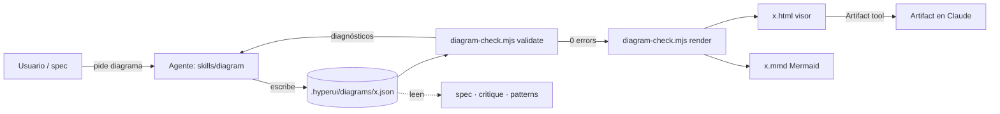
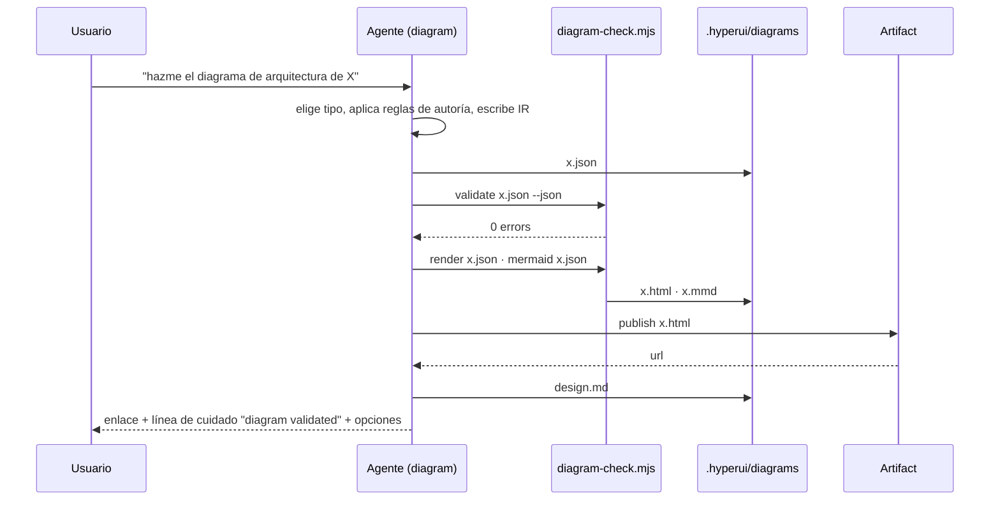
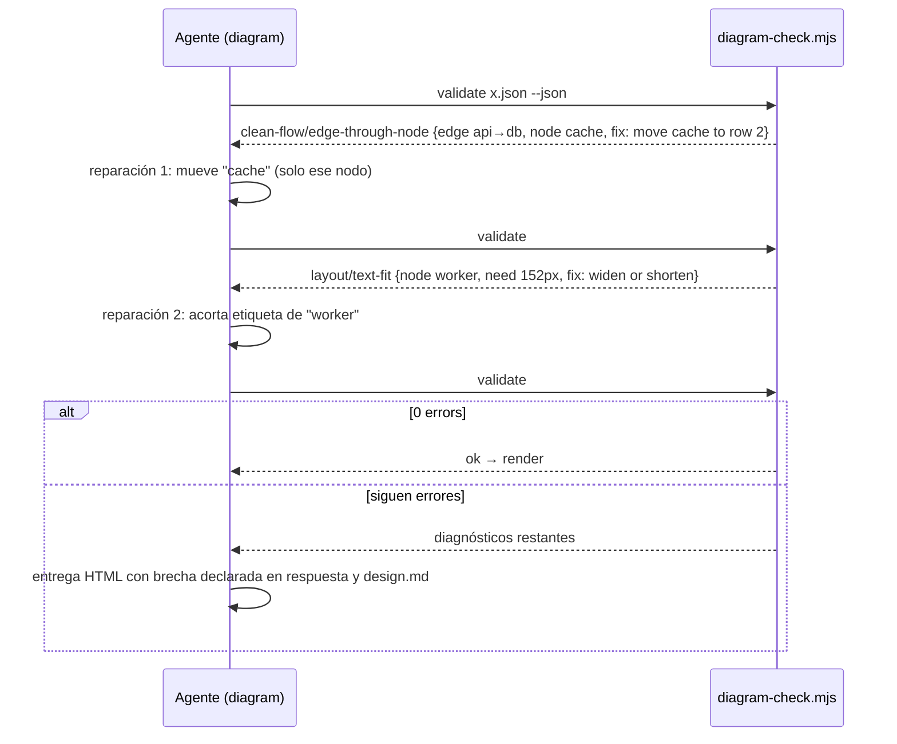

# Spec: Especialista `diagram` v1 — documento consolidado

**Date:** 2026-10-14
**Track:** full · consolidated

## PRD


### Problem
Cuando hyperui planea o explica una arquitectura, hoy solo tiene texto y Mermaid. El texto no se "ve" y Mermaid, con su auto-layout, produce diagramas que se leen mal en cuanto pasan de 6–8 nodos (el propio experimento de archify lo midió: el layout es el producto, no el CSS). Además nada de lo que se dibuja queda en una estructura que otro agente pueda leer después: el diagrama muere en la imagen. Quien usa hyperui para un producto con backend, integraciones o varios servicios necesita diagramas de arquitectura, flujo, secuencia, datos y ciclo de vida que sean bonitos, correctos y reutilizables, sin instalar una dependencia de terceros de 80k estrellas.

### Goal
Que hyperui genere, valide y entregue diagramas interactivos cuya fuente de verdad sea un JSON tipado propio, de modo que las personas los exploren y los agentes los lean.

### Success signal
- Un diagrama de la arquitectura de hyperui mismo (skills, scripts, hooks, memoria) generado y validado en una sola pasada, abierto como artifact y legible a 1440 px sin solapes — leído en el smoke de release.
- Tasa de validación: ≥ 90 % de los diagramas generados pasan el validador en ≤ 2 reparaciones — leído en el log del validador durante el smoke y, con consentimiento, en el evento `unit_closed skill=diagram iterations`.
- Al menos una especialista (`spec` en el diseño técnico) consume el JSON de un diagrama como entrada en vez del dibujo — verificado en el smoke de `spec`.
- Tamaño del visor HTML autocontenido < 60 KB sin fuentes embebidas — leído en el gate (`check.sh`).

### Users
- **Quien construye con hyperui** (dev/senior): pide "diagrama de la arquitectura", lo explora (foco, alcance), lo exporta a PNG o Mermaid para el README y lo itera.
- **Quien no es técnico**: ve el dibujo como artifact para entender qué se va a construir; no toca el JSON.
- **Las especialistas de hyperui** (`spec`, `critique`, `patterns`, `build`): leen el JSON para razonar sobre componentes, dependencias y flujos.

### Scope
**In (v1):**
- Cinco tipos: arquitectura, flujo (workflow), secuencia, flujo de datos, ciclo de vida.
- IR JSON tipada propia como fuente de verdad; el agente coloca los elementos (layout por criterio, no auto-layout).
- Validador sin dependencias: esquema, solapes, texto que cabe, aristas que no atraviesan nodos, legibilidad a 1440 px; cada error con código, elemento, medida y arreglos posibles; máximo dos reparaciones focalizadas antes de reportar la brecha.
- Visor HTML autocontenido con los tokens de hyperui: claro/oscuro, foco, alcance arriba/abajo, export PNG/SVG; el HTML embebe el JSON.
- Export Mermaid (estructura, sin layout) para READMEs de GitHub.
- Archivos en `.hyperui/diagrams/<nombre>.{json,html,mmd}` dentro del repo o carpeta del usuario (JSON y HTML se commitean ahí), publicación como artifact, y entrada "Diagrams" en la memoria del proyecto para que las demás especialistas lo usen.
- Atribución MIT a archify en `NOTICE` por los helpers de geometría y ajuste de texto que se adapten.

**Out (v1):**
- Enrutamiento fino de aristas (corredores, ritmo de rutas, cruces mínimos) — v2, cuando la v1 demuestre valor; el validador v1 solo exige que las aristas no atraviesen nodos.
- Evidencia verificada con git (`blob/<sha>/archivo#L10`) — v2; implica estado del repo y commits.
- Generar el diagrama leyendo código fuente automáticamente ("desde el repo") — v2; en v1 el agente parte de la descripción, el spec o lo que ya sabe del repo, y lo escribe a mano en la IR.
- Fuentes embebidas, iconos de marcas y el validador de 530 KB de archify — no se toman (licencias y tamaño).
- Comparación antes/después (delta) y traducción de etiquetas por locale — después.

### Use cases
#### UC-01: Diagrama desde una descripción o un spec
El usuario dice "hazme el diagrama de arquitectura de X" o `spec` lo necesita para el diseño técnico; obtiene un diagrama validado, abierto como artifact, y el JSON guardado.

#### UC-02: Explorar e iterar
El usuario abre el visor, enfoca un nodo, ve qué depende de qué (alcance arriba/abajo) y pide un cambio ("agrega la cola y mueve el worker"); el diagrama se actualiza sin que lo no tocado se mueva.

#### UC-03: Exportar para documentación
El usuario pide el PNG o el Mermaid para el README o una presentación y lo obtiene con los mismos nombres y colores.

#### UC-04: Un agente lee el diagrama
`spec`, `critique` o `patterns` abren el JSON y razonan sobre componentes, dependencias y flujos sin interpretar un dibujo.

#### UC-05: Diagrama que no pasa validación
El validador devuelve errores con arreglo sugerido; hyperui repara hasta dos veces; si sigue fallando, entrega lo que hay marcando la brecha, nunca un dibujo roto en silencio.

### Business rules
- El JSON es la única fuente de verdad; el HTML y el Mermaid se derivan de él y nunca se editan a mano.
- Nada se dibuja que no esté en el JSON; la interacción (foco, alcance) usa solo las aristas autoradas, nunca infiere topología del dibujo.
- Los diagramas (JSON y HTML) se guardan y commitean en el repo o carpeta del usuario, en `.hyperui/diagrams/`; nunca en el repo de hyperui, porque hyperui se distribuye como plugin.
- La especialista se invoca de las dos formas, como el resto: pidiendo "diagrama" a secas (enrutado por `/hyperui`) y directamente con `/hyperui:diagram` para expertos.
- Un diagrama no se entrega sin pasar el validador, salvo con la brecha declarada explícitamente.
- Por vista, el objetivo son 8–12 nodos primarios; más que eso se divide en varios diagramas enlazados.
- Colores y tipografía vienen de los tokens de hyperui (y del `design.md` del proyecto si existe), no de una paleta propia por diagrama.
- Las etiquetas van en `product_languages[0]` del perfil; los identificadores en inglés.
- El código adaptado de archify (MIT) conserva su aviso en `NOTICE` y una copia de su licencia dentro de la skill.

### Risks and dependencies
- La calidad del layout depende de la disciplina del agente al colocar (sin auto-layout); se mitiga con reglas de autoría explícitas y el validador.
- Chrome headless para el chequeo visual final no siempre está disponible (CI, otras máquinas); el validador estático debe bastar para aprobar.
- Mantener el visor < 60 KB limita funciones (sin fuentes embebidas, sin librerías).
- Cumplimiento de licencia MIT al adaptar helpers; se audita en el gate.

### Open questions
1. ¿Qué se muestra primero al usuario no técnico: el artifact del diagrama directamente o un resumen de una línea más el enlace? (propuesta en requisitos: el artifact directo con una línea de contexto)

### Revisions
- 2026-10-08: Resuelta la pregunta sobre dónde viven los diagramas: JSON y HTML se commitean en el repo o carpeta del usuario (`.hyperui/diagrams/`), nunca en el repo de hyperui, que se distribuye como plugin. Pasa a regla de negocio y se refleja en Scope. (comentario en el artifact)
- 2026-10-08: Resuelta la pregunta del nombre: ambos, "diagrama" vía `/hyperui` y `/hyperui:diagram` para expertos, como las demás especialistas. Pasa a regla de negocio. (comentario en el artifact)
- 2026-10-08: PRD aprobado en la compuerta.

## Requisitos

Los requisitos usan notación **EARS** (Easy Approach to Requirements Syntax): cada uno es un par condición–comportamiento (WHEN pasa algo, THE SYSTEM SHALL hace algo observable).


### Summary
La especialista `diagram` convierte una descripción, un spec o lo que hyperui ya sabe del proyecto en un diagrama cuya fuente de verdad es un JSON tipado propio; un validador sin dependencias lo mide y devuelve reparaciones; un visor HTML autocontenido lo muestra con foco y alcance; se exporta a PNG/SVG/Mermaid; y las demás especialistas leen el JSON. Importa porque hoy la arquitectura solo vive en texto o en Mermaid que se lee mal, y nada queda reutilizable.

### Scope
**In scope:** lo listado en el PRD como v1 (cinco tipos, IR, validador, visor, export Mermaid, archivos en `.hyperui/diagrams/`, artifact, atribución MIT).
**Out of scope:** enrutamiento fino de aristas, evidencia verificada con git, generación automática desde código fuente, fuentes/iconos embebidos, delta antes/después, traducción por locale.
**Affected areas:** `skills/diagram/` **new** (SKILL.md, `schema.json`, `references/`, `LICENSE-archify`) · `scripts/diagram-check.mjs` **new** (validador + enrutador + render) · `templates/diagram/viewer.html` **new** · `SKILL.md` raíz (fila de enrutamiento, compuertas, línea de cuidado) · `skills/spec/SKILL.md` (fase de diseño usa `diagram`) · `skills/critique/SKILL.md`, `skills/patterns/SKILL.md` (leen el JSON) · `scripts/check.sh` (lint de la skill y tamaño del visor) · `templates/hyperui/design.md` (sección `## Diagrams`) · `NOTICE` · `README.md`, `docs/architecture.md`, `CHANGELOG.md`, manifests.

### Requirements

#### REQ-001: Generar un diagrama desde una descripción o un spec
**User story:** Como quien construye con hyperui, quiero pedir "el diagrama de arquitectura de X" y obtenerlo validado, para ver y compartir la arquitectura sin dibujar a mano.

WHEN el usuario pide un diagrama (o `spec` lo necesita en la fase de diseño) y nombra o se infiere el tipo (arquitectura, flujo, secuencia, datos, ciclo de vida)
THE SYSTEM SHALL escribir la IR JSON en `.hyperui/diagrams/<nombre>.json`, validarla, renderizar `.hyperui/diagrams/<nombre>.html` y publicarla como artifact en el mismo turno.

**Acceptance:**
- [ ] Given un perfil con `product_languages: [es]` · When el usuario dice "hazme el diagrama de arquitectura de hyperui" · Then existen `<nombre>.json` y `<nombre>.html`, el validador reporta 0 errores, y la respuesta trae el enlace del artifact (o la ruta del HTML en headless).
- [ ] Given la fase de diseño de `spec` para un cambio multi-servicio · When `spec` propone el set de diagramas · Then al menos el de arquitectura se produce con `diagram` y su JSON queda referenciado en `02-design.md`.
- [ ] Given un tipo no reconocible en la petición · When se pide el diagrama · Then el sistema elige el tipo por señales (componentes → arquitectura; pasos → flujo; mensajes entre actores → secuencia; etapas de datos → datos; estados → ciclo de vida) y lo dice en una línea sin preguntar.
- [ ] Build passes: `bash scripts/check.sh`
- [ ] Tests pass: `node scripts/diagram-check.mjs --self-test`

#### REQ-002: La IR JSON es la fuente de verdad
**User story:** Como agente de hyperui, quiero que el diagrama exista como datos tipados, para razonar sobre componentes y dependencias sin interpretar un dibujo.

THE SYSTEM SHALL guardar cada diagrama, en el repo o carpeta del usuario (`.hyperui/diagrams/`, nunca en el repo del plugin), como un documento JSON con `schema_version`, `diagram_type` (`architecture|flow|sequence|dataflow|lifecycle`), `meta{title, lang}`, `nodes[]`, `groups[]`, `edges[]` y, para secuencia, `participants[]`/`messages[]`, rechazando campos desconocidos; el HTML y el Mermaid se derivan de él.

**Acceptance:**
- [ ] Given un JSON con un campo no definido en el esquema · When se valida · Then el validador falla con código `schema/unknown-property`, el elemento exacto y el arreglo "remove unsupported property X".
- [ ] Given un `.html` generado · When se abre su código · Then contiene el JSON completo embebido en `<script type="application/json" id="diagram-ir">` idéntico al `.json`.
- [ ] Given el `.json` de un diagrama · When `critique` o `patterns` lo leen · Then pueden listar nodos, grupos y aristas con etiquetas sin abrir el HTML.

#### REQ-003: El agente coloca, el validador mide
**User story:** Como usuario, quiero diagramas que se lean a primera vista, para no tener que descifrar un auto-layout.

WHEN el agente escribe la IR
THE SYSTEM SHALL exigir una posición en cuadrícula (`row`, `col`) por nodo y, al validar, comprobar: solapes o separación < 8 px entre nodos, texto que no cabe en su caja al tamaño mínimo legible, aristas que atraviesan un nodo ajeno (margen 2 px), aristas que no salen/entran por el lado indicado, etiquetas que pisan nodos u otras etiquetas, elementos fuera del lienzo, y texto proyectado < 6 px a 1440 px de ancho.

**Acceptance:**
- [ ] Given dos nodos en la misma celda · When se valida · Then error `layout/cell-collision` con los dos ids y la celda.
- [ ] Given un nodo con etiqueta más ancha que su caja · When se valida · Then error `layout/text-fit` con el ancho medido y el ancho requerido, y el arreglo "widen to N px or shorten label".
- [ ] Given una arista cuya ruta cruza un nodo ajeno · When se valida · Then error `clean-flow/edge-through-node` con el id del nodo y el segmento.
- [ ] Given un diagrama válido · When se valida · Then salida `0 errors` y código de salida 0 en < 1 s para ≤ 40 nodos.

#### REQ-004: Cada error trae su arreglo y el bucle de reparación es acotado
**User story:** Como usuario, quiero que hyperui repare el diagrama solo, pero que no se quede dando vueltas.

IF el validador devuelve errores THEN THE SYSTEM SHALL emitir cada uno con `{code, severity, message, subject{collection,index,id,from,to}, evidence{px,points,bounds}, supportedFixes[]}`, aplicar como máximo dos reparaciones focalizadas (solo los elementos nombrados) y, si persisten errores, entregar el diagrama marcando la brecha en la respuesta y en `design.md`, nunca un dibujo roto en silencio.

**Acceptance:**
- [ ] Given una IR con 3 errores · When el agente repara · Then tras ≤ 2 pasadas la IR valida, o la respuesta lista los errores restantes con su código.
- [ ] Given una reparación · When se compara la IR antes y después · Then solo cambiaron los elementos nombrados en `subject` (los demás nodos conservan `row/col`).
- [ ] Given la salida del validador · When se parsea · Then es JSON válido por línea (`--json`) y texto legible por defecto.

#### REQ-005: Visor autocontenido con foco, alcance y exportación
**User story:** Como usuario, quiero explorar el diagrama (enfocar un nodo, ver qué depende de qué) y exportarlo, sin instalar nada.

WHEN se renderiza un diagrama
THE SYSTEM SHALL producir un único archivo HTML con un SVG inline, colores solo por variables CSS (claro/oscuro según `prefers-color-scheme` y `data-theme`), foco por clic, alcance aguas arriba/abajo usando solo las aristas de la IR, enlace profundo `#focus=<id>`, exportación PNG y SVG, leyenda automática de los tipos presentes, y un tamaño < 60 KB sin fuentes embebidas.

**Acceptance:**
- [ ] Given el HTML generado · When se mide · Then `wc -c` < 61 440 y `check.sh` falla si lo supera.
- [ ] Given el visor abierto · When se hace clic en un nodo · Then se resaltan ese nodo, sus vecinos directos y, con "aguas abajo", todo lo alcanzable por aristas autoradas; nada que no esté en la IR se resalta.
- [ ] Given el visor · When se pulsa "PNG" · Then se descarga una imagen a 2× con el mismo tema visible.
- [ ] Given `prefers-color-scheme: dark` · When se abre · Then fondo, texto y aristas usan los tokens oscuros; contraste AA en etiquetas.
- [ ] Given una sesión interactiva con navegador · When se publica · Then la captura de evidencia del visor a 1280 queda en `design.md` (flujo browser-verify existente).

#### REQ-006: Tokens de hyperui y del proyecto
**User story:** Como dueño de la marca, quiero que los diagramas usen mis colores y tipografía, para que parezcan parte del producto.

THE SYSTEM SHALL tomar colores y tipografía de los tokens de hyperui y, si `.hyperui/design.md` define paleta/fuentes, de ahí; nunca de una paleta propia por diagrama; los siete tipos de componente (`frontend|backend|database|cloud|security|messagebus|external`) mapean a tokens, no a hex sueltos.

**Acceptance:**
- [ ] Given un proyecto con `design.palette.accent` definido · When se renderiza · Then el acento del visor es ese valor (variable CSS), sin hex literal en el SVG.
- [ ] Given un proyecto sin `design.md` · When se renderiza · Then se usan los tokens por defecto de hyperui (graphite + emerald).

#### REQ-007: Exportación Mermaid y camino rápido
**User story:** Como usuario, quiero pegar el diagrama en el README de GitHub.

WHEN el usuario pide Mermaid, o el destino es README/PR/chat, o el diagrama tiene ≤ 6 nodos sin grupos
THE SYSTEM SHALL exportar la estructura de la IR a `.hyperui/diagrams/<nombre>.mmd` (sin layout, sin validar) y, en el camino rápido, ofrecer el bloque Mermaid inline además de la IR; Mermaid pegado por el usuario se re-autora a la IR, nunca se valida ni se "embellece".

**Acceptance:**
- [ ] Given una IR de arquitectura · When se exporta · Then el `.mmd` es `flowchart` válido con un nodo por `nodes[]`, un `subgraph` por grupo y una arista por `edges[]` con su etiqueta.
- [ ] Given una IR de secuencia · When se exporta · Then el `.mmd` es `sequenceDiagram` con participantes y mensajes en orden.
- [ ] Given un bloque Mermaid pegado por el usuario · When pide "hazlo bonito" · Then se convierte a IR y pasa por el validador; el Mermaid original no se modifica.

#### REQ-008: Iterar sin mover lo que no se tocó
**User story:** Como usuario, quiero pedir cambios puntuales sin que el diagrama entero se reacomode.

WHEN el usuario pide un cambio sobre un diagrama existente
THE SYSTEM SHALL editar la IR existente (añadir, quitar o mover solo lo nombrado), revalidar y republicar el artifact en la **misma URL**, conservando `row/col` de los nodos no mencionados.

**Acceptance:**
- [ ] Given un diagrama publicado · When el usuario dice "agrega la cola entre API y worker" · Then el JSON gana un nodo y dos aristas, los demás nodos conservan `row/col`, y el artifact se republica en la misma URL.
- [ ] Given `state.md` · When se republica · Then `artifacts:` tiene una sola entrada para ese diagrama.

#### REQ-009: Reglas de autoría del agente
**User story:** Como hyperui, quiero reglas explícitas de colocación, para que el layout sea bueno sin auto-layout.

THE SYSTEM SHALL seguir, al escribir la IR, estas reglas: camino principal primero (izquierda → derecha o arriba → abajo según el tipo), ramas y almacenes directamente arriba o abajo de su dueño, retornos por un corredor libre, 8–12 nodos primarios por vista (más → dividir en diagramas enlazados), etiquetas de arista cortas (≤ 24 caracteres) y un solo acento de énfasis por vista.

**Acceptance:**
- [ ] Given una descripción con 20 componentes · When se genera · Then el resultado son ≥ 2 diagramas enlazados (`meta.related[]`) con ≤ 12 nodos cada uno, y la respuesta lo explica en una línea.
- [ ] Given la skill · When se lee · Then las reglas están en `skills/diagram/references/authoring.md` con las fórmulas de espaciado medidas (separación ≥ 8 px, etiqueta ≥ 6,5 px × caracteres + 21).

#### REQ-010: Integración con el resto de hyperui
**User story:** Como usuario, quiero que el diagrama aparezca donde hace falta sin pedirlo dos veces.

WHEN `spec` llega a la fase de diseño de un cambio multi-página, backend+UI o multi-servicio
THE SYSTEM SHALL producir el diagrama de arquitectura con `diagram` (y secuencia para el camino feliz cuando hay backend), enlazar los JSON en `02-design.md` y registrar los diagramas en `design.md` bajo `## Diagrams`; `critique` y `patterns` leen esos JSON cuando existen.

**Acceptance:**
- [ ] Given un spec multi-servicio · When se escribe `02-design.md` · Then contiene la ruta de ≥ 1 `.hyperui/diagrams/*.json` y el artifact del diagrama está enlazado.
- [ ] Given `/hyperui` · When el usuario escribe "diagrama", "arquitectura", "flujo", "secuencia" o "ciclo de vida" en cualquier idioma · Then la fila de enrutamiento manda a `diagram`.
- [ ] Given la línea de cuidado · When se entrega un diagrama · Then incluye `diagram validated` solo si el validador pasó.

#### REQ-011: Atribución y licencia
THE SYSTEM SHALL incluir en `NOTICE` la línea de atribución a Archify (MIT, commit `bb990b1`) y una copia de su licencia en `skills/diagram/LICENSE-archify`, y cada función adaptada lleva una cabecera `// Adapted from archify <path>@bb990b1 (MIT)`; no se incluyen la fuente embebida, los logos de marcas ni el validador generado de archify.

**Acceptance:**
- [ ] Given el repo · When se corre `grep -n "Archify" NOTICE` · Then aparece la línea; y `skills/diagram/LICENSE-archify` existe.
- [ ] Given `scripts/diagram-check.mjs` · When se buscan funciones adaptadas · Then cada una tiene la cabecera de origen.

### Non-functional requirements
- THE SYSTEM SHALL correr el validador con Node ≥ 20 sin dependencias de npm (`scripts/diagram-check.mjs` solo usa módulos nativos).
- THE SYSTEM SHALL mantener accesible el visor: `role`/`aria-label` en nodos, navegación por teclado del foco, contraste AA en ambos temas.
- THE SYSTEM SHALL escribir las etiquetas en `product_languages[0]` y los identificadores en inglés.
- THE SYSTEM SHALL funcionar en headless (`-p`, evals): sin Artifact tool, el `.html` queda en `.hyperui/diagrams/` y se da la ruta.
- THE SYSTEM SHALL pasar `scripts/check.sh` (lints de especialista) y añadir dos lints: tamaño del visor < 60 KB y presencia de `LICENSE-archify`.

### Open questions
Ninguna que bloquee el diseño; las tres del PRD quedan resueltas con las propuestas: los diagramas se commitean (JSON + HTML) con el resto de `.hyperui/`; el no-tech ve el artifact directo con una línea de contexto; existe `/hyperui:diagram` para expertos además del enrutado por `/hyperui`.

### Traceability to the PRD
| Use case | Requirements that cover it |
|---|---|
| UC-01 (diagrama desde descripción o spec) | REQ-001 (generar), REQ-002 (IR fuente de verdad), REQ-003 (colocar y medir), REQ-006 (tokens), REQ-009 (autoría), REQ-010 (integración) |
| UC-02 (explorar e iterar) | REQ-005 (visor), REQ-008 (iterar sin mover) |
| UC-03 (exportar) | REQ-005 (PNG/SVG), REQ-007 (Mermaid) |
| UC-04 (un agente lee el diagrama) | REQ-002 (IR), REQ-010 (integración) |
| UC-05 (no pasa validación) | REQ-004 (arreglos y bucle acotado) |

### Revisions

## Diseño


### Summary
Cambio **multi-componente dentro del plugin** (shape: multi-page de herramienta + un pipeline de datos, sin backend): una skill nueva (`skills/diagram/`), un script Node único que valida, enruta y renderiza (`scripts/diagram-check.mjs`), una plantilla de visor (`templates/diagram/viewer.html`), y cableado en la skill raíz, `spec`, `critique`, `patterns`, `check.sh` y `NOTICE`. Set de diagramas confirmado para este diseño: flowchart de componentes del pipeline, secuencia del camino feliz (pedir → IR → validar → render → artifact) y secuencia del fallo (validación con reparación acotada), más el esquema de la IR como tabla. Método base: `docs/research/archify-diagram-method.md` (MIT).

### Stack
| Decision | Pick | Why (one line) | Source |
|---|---|---|---|
| Lenguaje del script | JavaScript (Node ≥ 20, ESM `.mjs`) | el plugin ya exige Node ≥ 20 y no tiene toolchain de TS; cero dependencias de npm | `README.md` Requirements, `package.json` `engines` |
| Validación de esquema | chequeo estructural a mano | evita ajv (530 KB) y cualquier instalación en runtime | research §6 |
| Render | SVG inline generado por el mismo script + plantilla HTML | un solo archivo, sin librerías, < 60 KB | research §4 |
| Estilo | variables CSS mapeadas a tokens de hyperui / `design.md` | claro/oscuro y marca del proyecto sin hex sueltos | REQ-006 |
| Export Mermaid | función del mismo script | estructura sin layout para READMEs | REQ-007 |
| Hosting | N/A | artefactos locales + artifact de Claude | — |

### Affected components
| Component | Path | Kind | Change |
|---|---|---|---|
| Skill `diagram` | `skills/diagram/SKILL.md` | skill | **new** |
| Reglas de autoría | `skills/diagram/references/authoring.md` | docs | **new** |
| Catálogo de códigos de error | `skills/diagram/references/diagnostics.md` | docs | **new** |
| Esquema de la IR | `skills/diagram/schema.json` | data | **new** |
| Ejemplos de IR | `skills/diagram/references/examples/{architecture,flow,sequence,dataflow,lifecycle}.json` | data | **new** |
| Licencia archify | `skills/diagram/LICENSE-archify` | legal | **new** |
| Validador + enrutador + render + export | `scripts/diagram-check.mjs` | script | **new** |
| Plantilla del visor | `templates/diagram/viewer.html` | template | **new** |
| Skill raíz | `SKILL.md` | skill | modified (fila de enrutamiento, gate, línea de cuidado) |
| `spec` | `skills/spec/SKILL.md`, `skills/spec/references/design-template.md` | skill | modified (fase de diseño usa `diagram`) |
| `critique`, `patterns` | `skills/critique/SKILL.md`, `skills/patterns/SKILL.md` | skill | modified (leen `.hyperui/diagrams/*.json`) |
| Gate | `scripts/check.sh` | script | modified (lints: tamaño del visor, `LICENSE-archify`, `--self-test`) |
| Permisos | `scripts/permit.sh`, `allowed-tools` de las skills | script | modified (pre-aprobar `diagram-check.mjs`) |
| Memoria | `templates/hyperui/design.md` | template | modified (`## Diagrams`) |
| Atribución | `NOTICE` | legal | modified |
| Docs | `README.md`, `docs/architecture.md`, `CHANGELOG.md`, manifests | docs | modified (0.13.0) |

### Architecture
#### Execution mode
Herramienta local: el agente escribe la IR; `node scripts/diagram-check.mjs` corre en el proyecto del usuario (ruta absoluta del plugin, como `profile.sh`) y escribe los artefactos en `<root>/.hyperui/diagrams/`. Sin servidor, sin red. En headless el `.html` se entrega por ruta; en interactivo se publica como artifact.

#### El script: un archivo, cuatro subcomandos
```
node scripts/diagram-check.mjs validate <ir.json> [--json]          # esquema + geometría → diagnósticos, exit 0/1
node scripts/diagram-check.mjs render   <ir.json> [--out <dir>]     # valida y escribe <name>.html (+ .svg opcional)
node scripts/diagram-check.mjs mermaid  <ir.json> [--out <dir>]     # escribe <name>.mmd
node scripts/diagram-check.mjs --self-test                          # fixtures de references/examples + casos de error
```
Módulos internos (en el mismo archivo, secciones marcadas): `schema` (estructura, enums, ids, endpoints), `layout` (celda → px), `geometry` (adaptado de archify: `rectsOverlap`, `segmentIntersectsRect`, `properSegmentIntersection`, `segmentRectClearance`, `textUnits`, `fittedFontSize`), `router` (recto → L → Z → Dijkstra en malla ortogonal dispersa; port spread 16/14 px), `checks` (orden de reparación §Validación), `render` (SVG + plantilla), `mermaid`, `diagnostics` (forma común).

#### La IR (`skills/diagram/schema.json`)
Un documento por diagrama; campos desconocidos rechazados en todos los niveles.

| Campo | Tipo | Notas |
|---|---|---|
| `schema_version` | `1` | entero |
| `diagram_type` | `architecture\|flow\|sequence\|dataflow\|lifecycle` | define qué arreglos son obligatorios |
| `meta` | `{title, lang, description?, related?: [path], tokens?: {accent?, font?}}` | `lang` = `product_languages[0]` |
| `layout` | `{cols ≤ 12, cellW ≥ 40 (def 140), cellH ≥ 24 (def 64), gapX (def 48), gapY (def 56), origin [x,y] (def [40,80])}` | cuadrícula; sin `pos` libre en v1 |
| `nodes[]` | `{id, type, label, sublabel?, row, col, w?, h?, variant?}` | `type ∈ frontend\|backend\|database\|cloud\|security\|messagebus\|external\|actor\|state`; `id` `^[a-zA-Z][a-zA-Z0-9_-]*$` |
| `groups[]` | `{id, label, kind: boundary\|lane\|stage, wraps[ids], pad?}` | lanes/stages dan filas/columnas lógicas en flow/dataflow/lifecycle |
| `edges[]` | `{id?, from, to, label?, variant?: default\|emphasis\|security\|dashed\|return, fromSide?, toSide?, via?: [[x,y]]}` | `via` solo para defectos medidos |
| `participants[]`, `messages[]` | solo `sequence`: `{id,label,type}` / `{from,to,label,variant?,note?}` | el índice del mensaje es la y; columnas fijas |
| `states[]`, `transitions[]` | solo `lifecycle`: alias de `nodes`/`edges` con `type ∈ start\|active\|waiting\|decision\|success\|failure` | render con `step` "01" |

`lifecycle` y `dataflow` se validan con las mismas reglas geométricas que `architecture`; `flow` añade `mainPath[ids]` opcional para énfasis automático. Un esquema por tipo se expresa como "campos requeridos / permitidos" dentro de `schema.json`.

#### Validación (orden de reparación, cada regla con código)
| # | Código | Falla cuando | Arreglo sugerido |
|---|---|---|---|
| 1 | `schema/*` | campo desconocido, enum, id inválido, endpoint inexistente, ids duplicados | remove / choose one of / fix id |
| 2 | `layout/cell-collision`, `layout/out-of-grid` | dos nodos en la misma celda; `col ≥ cols` | move `<id>` to row r col c |
| 3 | `layout/node-overlap` | cajas a < 8 px | separate by N px |
| 4 | `layout/text-fit` | ancho requerido (`0.6·font·units + 8`) > caja | widen to N or shorten label |
| 5 | `clean-flow/edge-through-node` | segmento a ≤ 2 px de un nodo ajeno | reroute via / move `<id>` |
| 6 | `clean-flow/endpoint-side-direction` | primer/último segmento no sale/entra por el lado fijado | change `fromSide`/`toSide` |
| 7 | `composition/proper-crossing` (warning) | dos aristas no relacionadas forman una X | reorder rows / swap cols |
| 8 | `composition/label-overlap`, `composition/label-gap` | etiqueta pisa nodo/etiqueta; hueco < `6.5·units + 21` | labelAt / increase gap |
| 9 | `layout/out-of-canvas` | elemento fuera del viewBox | grow viewBox / move |
| 10 | `readability/projected-text` | texto proyectado < 6 px a 1440 px | split diagram / enlarge |
| 11 | `budget/too-many-nodes` (warning) | > 12 nodos primarios | split into related diagrams |

Forma del diagnóstico: `{code, severity: error|warning, message, subject{collection,index,id,from,to}, evidence{px,points,bounds}, supportedFixes[]}`; `--json` emite una línea JSON por diagnóstico; texto legible por defecto. Exit 1 con cualquier `error`.

#### El visor (`templates/diagram/viewer.html`, < 60 KB)
Marcadores `/* HYPERUI:TITLE */`, `/* HYPERUI:TOKENS */`, `/* HYPERUI:SVG */`, `/* HYPERUI:IR */`, `/* HYPERUI:LEGEND */`. Contiene: título + `<desc>`; tokens CSS (`--bg --surface --text --muted --accent --border` + `--<type>-fill/-stroke --arrow --mask`) con bloque `prefers-color-scheme` guardado por `:root:not([data-theme="light"])` y `:root[data-theme="dark"]`, override desde `meta.tokens`; SVG con `<defs>` (markers por variante, patrón de rejilla), orden de dibujo grupos → aristas → nodos → leyenda; cada nodo `<g data-node-id data-node-type tabindex="0" role="button" aria-label>` con `rect.c-mask` opaco; cada arista `<path data-edge-from data-edge-to data-edge-label data-points>` con esquinas `Q` y halo en cruces; `<script type="application/json" id="diagram-ir">` con la IR completa; JS (~300 líneas): foco por clic/teclado, vecinos, alcance aguas arriba/abajo por BFS sobre `data-edge-*`, `#focus=<id>` y `#reach=up|down`, export PNG 2× (serialize → canvas → toBlob) y SVG, toggle de tema, leyenda automática. Sin fuentes embebidas (stack del sistema + `meta.tokens.font` si existe).

#### Mermaid
`architecture|flow|dataflow` → `flowchart LR` (nodos con etiqueta, `subgraph` por grupo, `-->|label|`); `sequence` → `sequenceDiagram`; `lifecycle` → `stateDiagram-v2`. Sin estilos. Mermaid pegado por el usuario se parsea solo para extraer nodos/aristas hacia la IR.

#### Integración
- Skill raíz: fila de enrutamiento (`diagrama, arquitectura, flujo, secuencia, ciclo de vida, "cómo se conecta"`), gate "un diagrama no se entrega sin `0 errors` o brecha declarada", vocabulario de cuidado `diagram validated`.
- `spec` fase de diseño: para shapes backend+UI / multi-servicio / nueva plataforma, el diagrama de contenedores y la secuencia del camino feliz se producen con `diagram` (IR en `.hyperui/diagrams/`, enlace en `02-design.md`); el `flowchart`/`stateDiagram` Mermaid inline sigue para casos chicos (≤ 6 nodos) según REQ-007.
- `critique` y `patterns`: si existe `.hyperui/diagrams/*.json`, lo leen antes de opinar sobre arquitectura.
- `design.md`: sección `## Diagrams` con `nombre · tipo · ruta json · artifact url · validado (fecha)`.
- Permisos: `permit.sh` pre-aprueba `node <root>/scripts/diagram-check.mjs …`; `allowed-tools` de `diagram`, `spec`, `critique`, `patterns` incluyen esa línea.

#### Screens and content
N/A — no hay pantallas de producto; la única UI es el visor (descrito arriba) en `meta.lang`.

#### API contract
N/A — herramienta local, sin API.

#### Data model
N/A — sin base de datos; los artefactos son archivos en `.hyperui/diagrams/` del repo del usuario.

#### Auth and personal data
N/A — sin usuarios ni datos personales; la IR puede contener nombres de componentes del proyecto, que ya viven en el repo del usuario. Telemetría: solo `unit_closed skill=diagram iterations` con consentimiento.

#### Errors
Validación: diagnósticos con arreglo (tabla). Render: si el script falla por IR inválida no escribe HTML (fail-closed). Visor: si el JSON embebido no parsea, muestra un aviso en texto y el SVG estático sigue visible. Agente: tras 2 reparaciones, entrega con brecha declarada en la respuesta y en `design.md`.

#### Configuration and secrets
Ninguna variable ni secreto. Rutas: raíz del proyecto por `profile.sh root`; plugin por `${CLAUDE_PLUGIN_ROOT}`.

#### Async and concurrency
N/A — ejecución síncrona, un archivo por invocación.

### Diagrams
#### Componentes del pipeline
El agente autora la IR; el script la valida, enruta y renderiza; las demás especialistas consumen el JSON. Todo ocurre en el repo del usuario.


#### Camino feliz
Un diagrama válido a la primera: una sola pasada de validación, render y publicación en el mismo turno.


#### Fallo de validación con reparación acotada
El validador nombra el elemento y el arreglo; el agente corrige solo ese vecindario; tras dos intentos entrega con brecha declarada.


### Decisions (ADR-lite)
- **Un solo script Node sin dependencias** — Context: el plugin no tiene toolchain ni `node_modules`; archify arrastra ajv y 400 KB de visor. Decision: `scripts/diagram-check.mjs` autocontenido (esquema a mano, geometría propia/adaptada). Consequences: más código nuestro (~1.5k líneas), cero instalación en runtime, fácil de auditar. Status: accepted.
- **Cuadrícula obligatoria, sin posiciones libres en v1** — Context: la calidad depende de que el agente coloque bien; coordenadas libres multiplican errores. Decision: `row/col` + `layout` por diagrama; `via` solo para defectos medidos. Consequences: menos expresividad, validación más simple y reparaciones deterministas. Status: accepted.
- **Visor < 60 KB sin fuentes** — Context: archify embebe 96 KB de fuentes y 400 KB de JS. Decision: stack de fuentes del sistema, JS mínimo (foco, alcance, export). Consequences: menos funciones (sin minimapa, lentes, presentación), archivos ligeros y commiteables. Status: accepted.
- **Mermaid solo como export y camino rápido** — Context: archify midió que Mermaid estilizado pierde contra el layout autorado. Decision: `.mmd` derivado para READMEs; inline solo ≤ 6 nodos sin grupos. Consequences: dos representaciones, pero una sola fuente de verdad. Status: accepted.
- **Enrutamiento fino y evidencia git en v2** — Context: coste y riesgo de la v1. Decision: el enrutador v1 hace recto/L/Z/Dijkstra y el validador exige "no atraviesa nodos"; cruces como warning. Consequences: diagramas correctos pero no siempre óptimos; se mide en uso real antes de invertir. Status: accepted.
- **Atribución MIT explícita** — Decision: `NOTICE` + `skills/diagram/LICENSE-archify` + cabecera por función adaptada. Consequences: cumplimiento sin vendorizar su código. Status: accepted.

### Implementation considerations
#### Security
Sin red ni entrada externa salvo el JSON del propio agente; el script no ejecuta nada del contenido; etiquetas escapadas al generar SVG/HTML (`<`, `>`, `&`, comillas) para evitar inyección en el visor; rutas de salida limitadas a `<root>/.hyperui/diagrams/`.

#### Performance
Validación < 1 s para ≤ 40 nodos (medido en `--self-test`); Dijkstra sobre malla dispersa (celdas + stubs), no píxel a píxel.

#### Accessibility and i18n
Nodos con `role="button"`, `tabindex`, `aria-label`; foco visible; contraste AA en ambos temas; etiquetas en `meta.lang` (= `product_languages[0]`); chrome del visor (~10 cadenas) en inglés con override por `meta.lang` para es/en.

#### Testing strategy
TDD: `--self-test` escribe primero los casos: (1) cinco ejemplos válidos → 0 errors; (2) un caso por código de error con el arreglo esperado; (3) render produce HTML < 61 440 bytes con un solo `<svg>` y JSON embebido idéntico; (4) Mermaid export válido por tipo; (5) determinismo: misma IR → mismo SVG. `check.sh` corre `--self-test`, el lint de tamaño y la presencia de `LICENSE-archify`. Smoke: diagrama de la arquitectura de hyperui generado por la skill y publicado.

#### Observability
`validate --json` es parseable; `unit_closed skill=diagram iterations` con consentimiento; nada más.

#### Docs to update
`README.md` (How it works + tabla de especialistas + sección "Diagrams"), `docs/architecture.md` (árbol, gate, memoria), `CHANGELOG.md` 0.13.0, `docs/research/README.md` (fila del método), manifests.

### Open questions
Ninguna que bloquee las tareas. Pregunta del PRD (qué ve primero el no-tech): el artifact directo con una línea de contexto; se recoge en la skill §tono.

### Traceability REQ → decisión
| REQ | Decisión / componente |
|---|---|
| REQ-001 generar | skill §procedimiento, `render`, Artifact |
| REQ-002 IR fuente de verdad | `schema.json`, JSON embebido, lectura por `critique`/`patterns` |
| REQ-003 colocar y medir | `layout` + `checks` 2–10 |
| REQ-004 arreglos y bucle acotado | `diagnostics` + skill §reparación |
| REQ-005 visor | `templates/diagram/viewer.html` + lint de tamaño |
| REQ-006 tokens | `HYPERUI:TOKENS` + `meta.tokens` desde `design.md` |
| REQ-007 Mermaid | `mermaid` subcomando + skill §camino rápido |
| REQ-008 iterar sin mover | skill §iteración (editar IR existente, misma URL) |
| REQ-009 autoría | `references/authoring.md` |
| REQ-010 integración | skill raíz, `spec`, `critique`, `patterns`, `design.md` |
| REQ-011 atribución | `NOTICE`, `LICENSE-archify`, cabeceras |

### Revisions

## Tareas


Repo: `~/personal/hyperui` (rama `feature/diagram-skill` desde `main`, trabajo en worktree aislado; sin amend, sin force-push). Gate de cada tarea: `bash scripts/check.sh` · `node scripts/diagram-check.mjs --self-test` · `npm run version-check`. TDD: los casos de `--self-test` se escriben antes del código que los hace pasar. Presupuesto de verificación: gate + un smoke; sin evals.

### Implementation plan

#### Wave 1 — Cimientos: esquema, ejemplos, geometría, licencia
Sin dependencias entre sí.

- [ ] **TASK-001**: Esquema de la IR y ejemplos de los cinco tipos
  - **What**: `skills/diagram/schema.json` con campos requeridos/permitidos por `diagram_type`, enums (`type`, `variant`, `kind`, lados), patrón de `id`, límites de `layout`; cinco IR de ejemplo válidas y pequeñas (6–10 nodos) que luego sirven de fixtures y de documentación.
  - **Files**: `skills/diagram/schema.json` (new), `skills/diagram/references/examples/{architecture,flow,sequence,dataflow,lifecycle}.json` (new)
  - **Tests first**: en `--self-test`: los cinco ejemplos pasan el chequeo de esquema; un documento con campo desconocido falla con `schema/unknown-property`; `id` inválido falla con `schema/id-pattern`; endpoint inexistente falla con `schema/unknown-endpoint`.
  - **Commands**: `node scripts/diagram-check.mjs --self-test` (falla hasta TASK-002) · `bash scripts/check.sh`
  - **Acceptance**: los cinco JSON parsean, cada uno declara `schema_version: 1`, `diagram_type`, `meta.title`, `meta.lang`; el esquema cubre todos sus campos; ningún campo fuera del esquema.
  - **Covers**: REQ-002 (IR fuente de verdad)
  - **Depends on**: none

- [ ] **TASK-002**: Núcleo del script: esquema, layout a píxeles, geometría, diagnósticos y `--self-test`
  - **What**: `scripts/diagram-check.mjs` con el CLI (`validate`, `--json`, `--self-test`), chequeo estructural a mano contra `schema.json`, conversión celda → px (`layout` por defecto 140×64, gaps 48/56, origen 40,80), helpers de geometría adaptados de archify con cabecera `// Adapted from archify <path>@bb990b1 (MIT)` (`rectsOverlap`, `segmentIntersectsRect`, `properSegmentIntersection`, `segmentRectClearance`, `textUnits` con CJK = 2, `fittedFontSize`/`minimumNodeTextWidth`), y la forma común de diagnóstico `{code, severity, message, subject, evidence, supportedFixes}`; exit 1 con cualquier error.
  - **Files**: `scripts/diagram-check.mjs` (new), `skills/diagram/references/diagnostics.md` (new, catálogo de códigos)
  - **Tests first**: fixtures de error inline en `--self-test`: `layout/cell-collision`, `layout/out-of-grid`, `layout/node-overlap`, `layout/text-fit` (mide `0.6·font·units + 8`), `layout/out-of-canvas`; cada uno comprueba `code`, `subject.id` y que `supportedFixes` no esté vacío; salida `--json` parsea línea a línea.
  - **Commands**: `node scripts/diagram-check.mjs --self-test` · `node scripts/diagram-check.mjs validate skills/diagram/references/examples/architecture.json --json` · `bash -n`/`node --check scripts/diagram-check.mjs`
  - **Acceptance**: `--self-test` verde para los casos de esquema y layout; `validate` de los cinco ejemplos → `0 errors`, exit 0, < 1 s; sin `import` de paquetes npm (solo `node:fs`, `node:path`, `node:process`).
  - **Covers**: REQ-002, REQ-003 (colocar y medir), REQ-004 (diagnósticos)
  - **Depends on**: TASK-001 (fixtures) — puede empezar en paralelo con un fixture mínimo

- [ ] **TASK-003**: Licencia y atribución
  - **What**: copiar la licencia MIT de archify a `skills/diagram/LICENSE-archify`; añadir a `NOTICE` la línea de atribución (commit `bb990b1`, Copyright tt-a1i / Cocoon AI); lint en `check.sh` que exige ambos.
  - **Files**: `skills/diagram/LICENSE-archify` (new), `NOTICE` (modified), `scripts/check.sh` (modified)
  - **Tests first**: `check.sh` falla si falta `LICENSE-archify` o la línea "Archify" en `NOTICE` (probar quitándolos en un temp copy).
  - **Commands**: `bash scripts/check.sh`
  - **Acceptance**: `grep -n Archify NOTICE` encuentra la línea; el archivo de licencia contiene el texto MIT completo; gate verde.
  - **Covers**: REQ-011 (atribución)
  - **Depends on**: none

#### Wave 2 — Enrutador, chequeos de flujo, visor y Mermaid
Depende de la ola 1.

- [ ] **TASK-004**: Enrutador ortogonal y chequeos de flujo
  - **What**: en `diagram-check.mjs`: puertos en el punto medio del lado con *port spread* (gutter 16 px, paso 14 px); escalera de rutas recto → L → Z → Dijkstra en malla ortogonal dispersa (bordes de obstáculos + stubs de puerto); chequeos `clean-flow/edge-through-node` (≤ 2 px), `clean-flow/endpoint-side-direction`, `composition/proper-crossing` (warning), `composition/label-overlap`, `composition/label-gap` (`6.5·units + 21`), `readability/projected-text` (< 6 px a 1440), `budget/too-many-nodes` (> 12, warning); etiquetas de arista colocadas en el segmento más largo con `labelAt` opcional.
  - **Files**: `scripts/diagram-check.mjs` (modified)
  - **Tests first**: fixture con una arista que atraviesa un nodo → `edge-through-node` con el id; fixture con `fromSide: top` y ruta que sale por la derecha → `endpoint-side-direction`; fixture con etiqueta larga en hueco corto → `label-gap` con la medida; fixture de 14 nodos → warning `too-many-nodes`; ruta Dijkstra evita obstáculo y termina con segmentos ≥ 8 px; determinismo (misma IR → mismos puntos).
  - **Commands**: `node scripts/diagram-check.mjs --self-test`
  - **Acceptance**: todos los casos verdes; los cinco ejemplos siguen en `0 errors`; cada ruta de los ejemplos tiene ≤ 2 codos.
  - **Covers**: REQ-003, REQ-004, REQ-009 (reglas medibles)
  - **Depends on**: TASK-002

- [ ] **TASK-005**: Visor autocontenido y subcomando `render`
  - **What**: `templates/diagram/viewer.html` con marcadores `/* HYPERUI:TITLE|TOKENS|SVG|IR|LEGEND */`, tokens CSS con los tres bloques de tema, `<svg role="img">` con `<title>/<desc>`, `<defs>` (markers por variante, rejilla), orden grupos → aristas → nodos → leyenda, `rect.c-mask`, halo en cruces, `data-node-*`/`data-edge-*`, `<script type="application/json" id="diagram-ir">`; JS: foco (clic/teclado), vecinos, alcance arriba/abajo (BFS sobre `data-edge-*`), `#focus=<id>` y `#reach=up|down`, export PNG 2× y SVG, toggle de tema, leyenda automática. `render` escribe `<name>.html` (y `--svg` opcional) solo si `validate` da 0 errores; escapa `<>&"` en todo texto.
  - **Files**: `templates/diagram/viewer.html` (new), `scripts/diagram-check.mjs` (modified)
  - **Tests first**: `--self-test`: render de los cinco ejemplos produce HTML con exactamente un `<svg>`, sin `NaN|undefined|Infinity` en atributos numéricos, JSON embebido idéntico a la IR (`JSON.stringify` canónico), tamaño < 61 440 bytes, sin colores hex literales dentro del SVG (`grep -c '#[0-9a-f]\{6\}'` = 0 fuera del bloque de tokens); render de una IR inválida no escribe archivo.
  - **Commands**: `node scripts/diagram-check.mjs render skills/diagram/references/examples/architecture.json --out /tmp/x` · headless Chrome screenshot del HTML a 1280 (evidencia) · `bash scripts/check.sh` (lint de tamaño)
  - **Acceptance**: HTML abre en Chrome claro y oscuro, foco y alcance funcionan con teclado y ratón (verificado con una captura por tema), PNG se descarga a 2×; `check.sh` falla si el visor renderizado supera 60 KB.
  - **Covers**: REQ-005 (visor), REQ-006 (tokens), REQ-002 (JSON embebido)
  - **Depends on**: TASK-004

- [ ] **TASK-006**: Export Mermaid y re-autoría de Mermaid pegado
  - **What**: subcomando `mermaid` (`flowchart LR` con `subgraph` por grupo y `-->|label|`; `sequenceDiagram`; `stateDiagram-v2`); parser mínimo de Mermaid pegado (flowchart/sequence) → IR esqueleto con `row/col` por orden de aparición, para que el agente lo termine.
  - **Files**: `scripts/diagram-check.mjs` (modified)
  - **Tests first**: cada ejemplo exporta un `.mmd` cuyo conteo de nodos/aristas coincide con la IR; `sequence` conserva el orden de mensajes; un `flowchart` pegado con 4 nodos → IR con 4 nodos y las aristas correctas.
  - **Commands**: `node scripts/diagram-check.mjs mermaid skills/diagram/references/examples/sequence.json --out /tmp/x` · `--self-test`
  - **Acceptance**: `.mmd` renderiza en GitHub (verificado pegándolo en un gist o en el README del smoke); casos verdes.
  - **Covers**: REQ-007 (Mermaid)
  - **Depends on**: TASK-002

#### Wave 3 — La skill y su cableado
Depende de la ola 2.

- [ ] **TASK-007**: `skills/diagram/SKILL.md` y referencias de autoría
  - **What**: SKILL.md (≤ 180 líneas): frontmatter estándar (`user-invocable: false`, preámbulo exacto, `allowed-tools` con `Bash(node ${CLAUDE_PLUGIN_ROOT}/scripts/diagram-check.mjs *)` y `profile.sh`), elección del tipo por señales, reglas de autoría (camino principal, ramas/almacenes junto al dueño, retornos por corredor libre, 8–12 nodos, etiquetas ≤ 24 chars, un énfasis por vista), procedimiento (IR → validate → ≤ 2 reparaciones focalizadas → render → mermaid → artifact → `design.md ## Diagrams` → `state.md`), iteración sin mover lo no tocado (misma URL), tono por arquetipo (no-tech: artifact + 1 línea), camino rápido Mermaid, línea de cuidado `diagram validated`, telemetría `unit_closed`, `## Sources`. `references/authoring.md` con las fórmulas medidas; `references/diagnostics.md` ya existe (TASK-002).
  - **Files**: `skills/diagram/SKILL.md` (new), `skills/diagram/references/authoring.md` (new)
  - **Tests first**: `check.sh` (lints de especialista) verde; un smoke headless genera el diagrama de arquitectura de un fixture pequeño y produce json+html+mmd con 0 errores.
  - **Commands**: `bash scripts/check.sh` · `claude --plugin-dir . -p "hazme el diagrama de arquitectura de este proyecto" --permission-mode acceptEdits` en un fixture
  - **Acceptance**: la skill pasa todos los lints; el smoke deja `.hyperui/diagrams/<name>.{json,html,mmd}`, `design.md ## Diagrams` y responde con ruta/enlace, línea de cuidado y opciones.
  - **Covers**: REQ-001, REQ-004, REQ-008, REQ-009, REQ-010 (parcial)
  - **Depends on**: TASK-005, TASK-006

- [ ] **TASK-008**: Cableado en el resto del plugin
  - **What**: skill raíz (fila de enrutamiento `diagram`, gate "sin `0 errors` no se entrega", vocabulario `diagram validated`; ≤ 220 líneas), `spec` (fase de diseño: shapes backend+UI/multi-servicio/nueva plataforma producen contenedores + secuencia con `diagram`; `design-template.md` lo refleja), `critique` y `patterns` (leer `.hyperui/diagrams/*.json` si existe), `permit.sh` (pre-aprobar `node <root>/scripts/diagram-check.mjs`), `templates/hyperui/design.md` (`## Diagrams`), `check.sh` (`--self-test` dentro del gate).
  - **Files**: `SKILL.md`, `skills/spec/SKILL.md`, `skills/spec/references/design-template.md`, `skills/critique/SKILL.md`, `skills/patterns/SKILL.md`, `scripts/permit.sh`, `templates/hyperui/design.md`, `scripts/check.sh` (modified)
  - **Tests first**: `check.sh` verde con `--self-test` incluido; `permit.sh` devuelve allow para el comando del script y nada para `rm -rf /`; caps de líneas respetados.
  - **Commands**: `bash scripts/check.sh` · prueba unitaria de `permit.sh` con un JSON de entrada
  - **Acceptance**: `grep -n diagram SKILL.md skills/spec/SKILL.md skills/critique/SKILL.md skills/patterns/SKILL.md` muestra el cableado; gate verde.
  - **Covers**: REQ-010 (integración), REQ-005 (lint de tamaño en el gate)
  - **Depends on**: TASK-007

#### Wave 4 — Docs, release y smoke real
Depende de la ola 3.

- [ ] **TASK-009**: Documentación y versión 0.13.0
  - **What**: README (bullet en How it works, fila en especialistas, sección "Diagrams" con una captura del visor y el bloque Mermaid exportado), `docs/architecture.md` (árbol, gate, memoria `diagrams/`), `docs/research/README.md` (fila del método archify), CHANGELOG `## 0.13.0`, manifests y `package.json` a 0.13.0.
  - **Files**: `README.md`, `docs/architecture.md`, `docs/research/README.md`, `CHANGELOG.md`, `.claude-plugin/plugin.json`, `.claude-plugin/marketplace.json`, `package.json` (modified)
  - **Tests first**: `npm run version-check`; `check.sh`.
  - **Commands**: `npm run version-check` · `bash scripts/check.sh`
  - **Acceptance**: versiones iguales en los tres archivos; README sin referencias a empresas; gate verde.
  - **Covers**: REQ-010, REQ-011
  - **Depends on**: TASK-008

- [ ] **TASK-010**: Smoke real: el diagrama de arquitectura de hyperui
  - **What**: con la skill ya cableada, generar `.hyperui/diagrams/hyperui-architecture.{json,html,mmd}` del propio plugin (entrada, especialistas, scripts, hooks, memoria `.hyperui/`, artifacts), publicarlo como artifact, pegar el `.mmd` en `docs/architecture.md` y usar la captura en el README (TASK-009 lo deja preparado).
  - **Files**: `.hyperui/diagrams/hyperui-architecture.*` (new, en este repo porque hyperui es a la vez plugin y proyecto), `docs/architecture.md`, `README.md` (modified)
  - **Tests first**: `validate` → 0 errors en ≤ 2 reparaciones; captura a 1280 claro y oscuro sin solapes.
  - **Commands**: `claude --plugin-dir . -p "hazme el diagrama de arquitectura de hyperui"` · `node scripts/diagram-check.mjs validate .hyperui/diagrams/hyperui-architecture.json`
  - **Acceptance**: artifact publicado y enlazado en `design.md ## Diagrams`; iteraciones registradas; el Mermaid renderiza en GitHub.
  - **Covers**: REQ-001, REQ-005, REQ-007, señal de éxito 1 del PRD
  - **Depends on**: TASK-009

### Summary
| Task | Title | Wave | Covers | Status |
|---|---|---|---|---|
| TASK-001 | Esquema de la IR y ejemplos | 1 | REQ-002 | pending |
| TASK-002 | Núcleo del script: esquema, layout, geometría, diagnósticos, self-test | 1 | REQ-002, 003, 004 | pending |
| TASK-003 | Licencia y atribución | 1 | REQ-011 | pending |
| TASK-004 | Enrutador y chequeos de flujo | 2 | REQ-003, 004, 009 | pending |
| TASK-005 | Visor autocontenido y `render` | 2 | REQ-005, 006, 002 | pending |
| TASK-006 | Export Mermaid y re-autoría | 2 | REQ-007 | pending |
| TASK-007 | SKILL.md y referencias de autoría | 3 | REQ-001, 004, 008, 009, 010 | pending |
| TASK-008 | Cableado en el plugin | 3 | REQ-010, 005 | pending |
| TASK-009 | Docs y 0.13.0 | 4 | REQ-010, 011 | pending |
| TASK-010 | Smoke real: arquitectura de hyperui | 4 | REQ-001, 005, 007 | pending |

### Revisions

## Trazabilidad UC → REQ → decisión → TASK
| UC | REQ | Decisión / componente | TASK |
|---|---|---|---|
| UC-01 diagrama desde descripción o spec | REQ-001, 002, 003, 006, 009, 010 | skill §procedimiento · schema.json · layout+checks · tokens · authoring.md · cableado | TASK-001, 002, 004, 005, 007, 008, 010 |
| UC-02 explorar e iterar | REQ-005, 008 | viewer.html · skill §iteración (misma URL) | TASK-005, 007 |
| UC-03 exportar | REQ-005, 007 | export PNG/SVG · subcomando mermaid | TASK-005, 006 |
| UC-04 un agente lee el diagrama | REQ-002, 010 | JSON embebido · critique/patterns leen .hyperui/diagrams | TASK-001, 002, 008 |
| UC-05 no pasa validación | REQ-004 | diagnostics + repair loop ≤ 2 | TASK-002, 004, 007 |
| — (licencia) | REQ-011 | NOTICE · LICENSE-archify · cabeceras | TASK-003, 009 |
